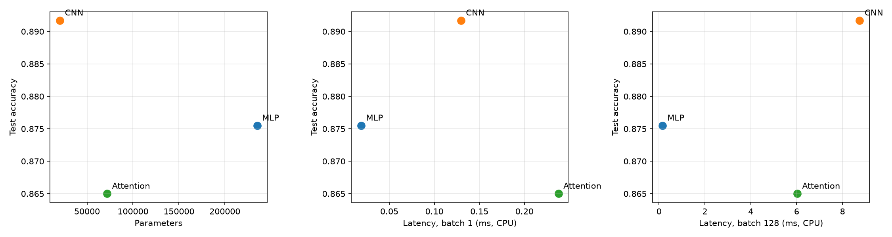

# Lab 3: Architectures and their costs

## 1. Setup
Fashion-MNIST, Normalize((0.2860,), (0.3530,)), 55k/5k/10k train/val/test split (seed 0),
batch 128. Training: Adam, lr 0.001, 5 epochs on `cpu`.
Latency: CPU, eval mode, `torch.no_grad()`, 10 warm-up runs, median of 100 runs (batch 1) and 20 runs (batch 128).

## 2. Models and parameter counts (torchinfo)
Models follow the lab spec exactly. Note that the specified layer sizes do **not** all land in the
100k-150k target: the MLP is above it and the CNN and Attention models are below it (table below).
The Attention model also has a learnable positional embedding (16x64 = 1,024 params), which the spec does not
mention; I added it because mean-pooling alone would discard patch position.

## 3. Cost: hand-calculated vs measured FLOPs
Hand-calculated FLOPs for one layer of each type:

| Model | Layer | FLOPs |
|---|---|---|
| MLP | Linear 784->256 | 401,408 |
| CNN | Conv2d 16->32 @14x14 | 1,806,336 |
| Attention | 1 encoder layer (seq=16,d=64) | 1,114,112 |

Breakdown of one Transformer encoder layer (seq=16, d_model=64, ff=128):

| Term | FLOPs |
|---|---|
| QKV projections | 393,216 |
| scores QK^T | 32,768 |
| attn x V | 32,768 |
| output projection | 131,072 |
| FFN linear1 | 262,144 |
| FFN linear2 | 262,144 |

Whole-model comparison (batch 1):

| Model | Params | Hand FLOPs | thop MACs | thop MACs x2 | thop x2 / hand |
|---|---|---|---|---|---|
| MLP | 235,146 | 469,504 | 234,752 | 469,504 | 1.00 |
| CNN | 20,490 | 2,063,488 | 1,031,744 | 2,063,488 | 1.00 |
| Attention | 71,818 | 2,329,856 | 591,488 | 1,182,976 | 0.51 |

**Explaining the gap.**
1. `thop` reports multiply-accumulates (MACs), and one MAC = 2 FLOPs, so compare against MACs x2.
2. `thop` only has counting rules for known module types. `nn.MultiheadAttention` is not handled, and its internal
   QK^T and attention x V matmuls are functional ops, so the attention scores are not counted at all.
3. My hand count ignores bias adds, ReLU, softmax, LayerNorm, residual adds and pooling (low-FLOP but memory-bound
   ops). `thop` ignores most of these as well, so any small remaining difference comes from them.

## 4. Latency and accuracy

| Model | Latency b=1 (ms) | Latency b=128 (ms) | Test acc |
|---|---|---|---|
| MLP | 0.019 | 0.150 | 0.8755 |
| CNN | 0.130 | 8.748 | 0.8917 |
| Attention | 0.238 | 6.025 | 0.8650 |

## 5. Trade-off plots

## 6. Which architecture is most cost-effective?
Highest test accuracy: **CNN**. Best accuracy per ms: **MLP** at batch 1 and **MLP** at batch 128.

Access-pattern explanation (Ch. 4.6-4.7):
- **MLP** uses dense matrix-vector or matrix-matrix products. Each weight is used once per sample, so at batch 1
  arithmetic intensity is about 2 FLOPs per weight read and the layer is memory-bandwidth bound. Larger batches reuse each
  loaded weight across samples, so latency per sample drops sharply.
- **CNN** shares one small kernel across all spatial positions, giving heavy weight reuse and good locality
  (sliding-window access, small working set that fits in cache). It has few parameters but relatively many FLOPs,
  so it is compute-bound rather than bandwidth-bound.
- **Attention** needs dense projections plus seq^2 score matrices, softmax and LayerNorm, which are element-wise,
  memory-bound ops. It also launches many more small kernels, so it pays fixed overhead that dominates at batch 1.
  Its cost grows quadratically with sequence length, which is harmless at seq=16 but would not scale.

Conclusion: *(edit in your own words after checking the numbers above match this reasoning)*
